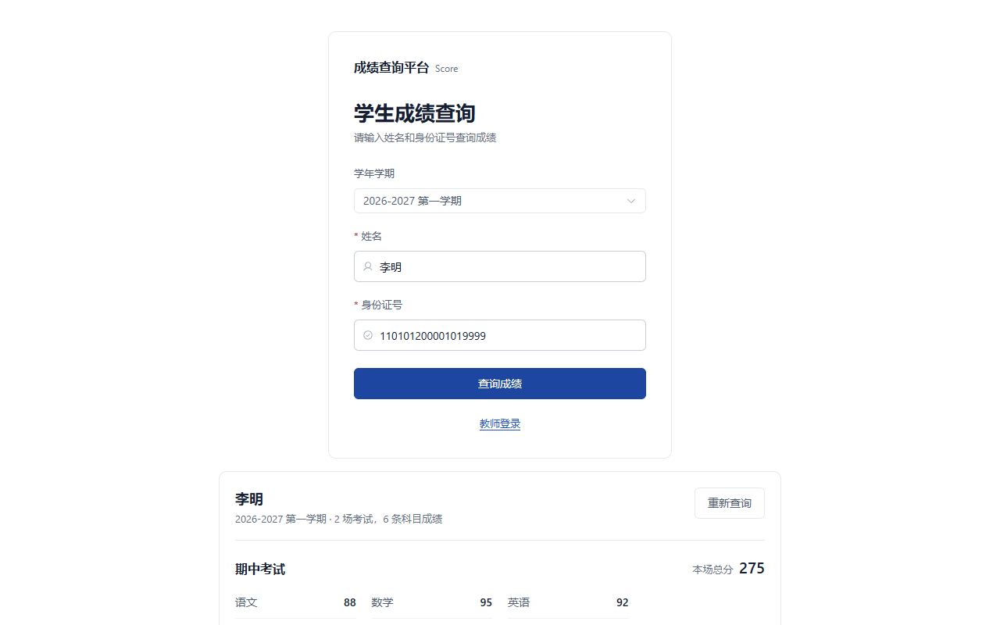
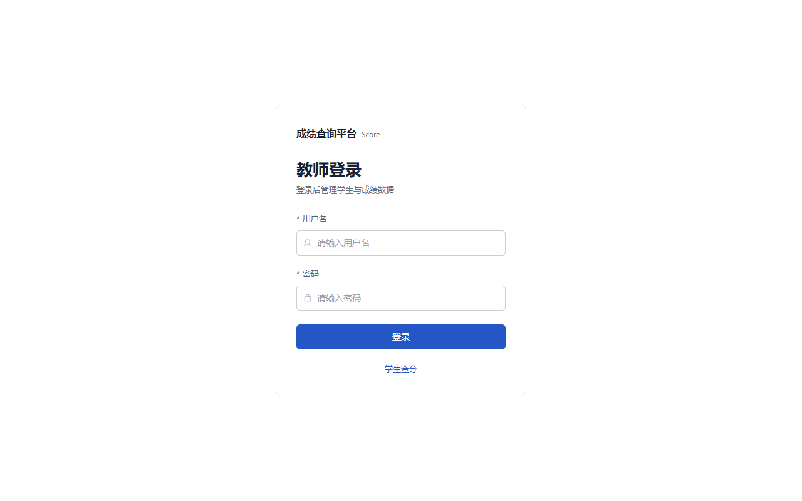
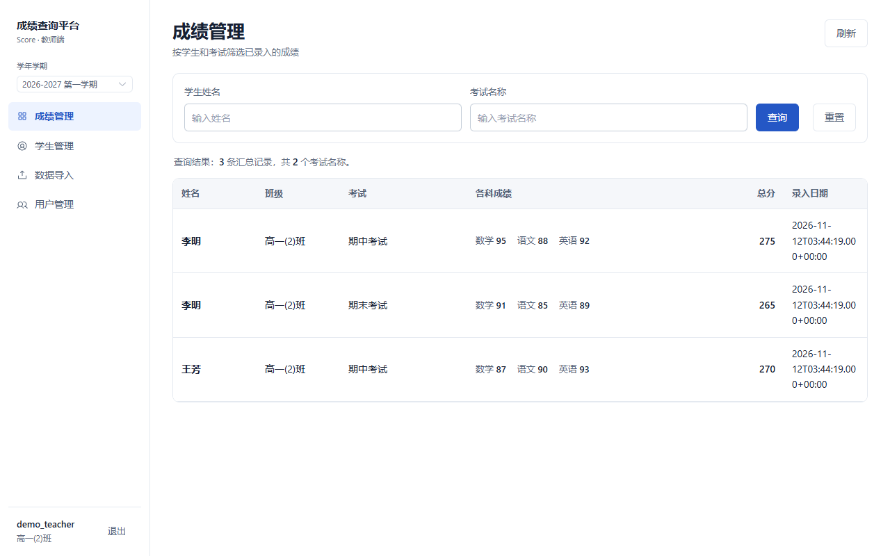
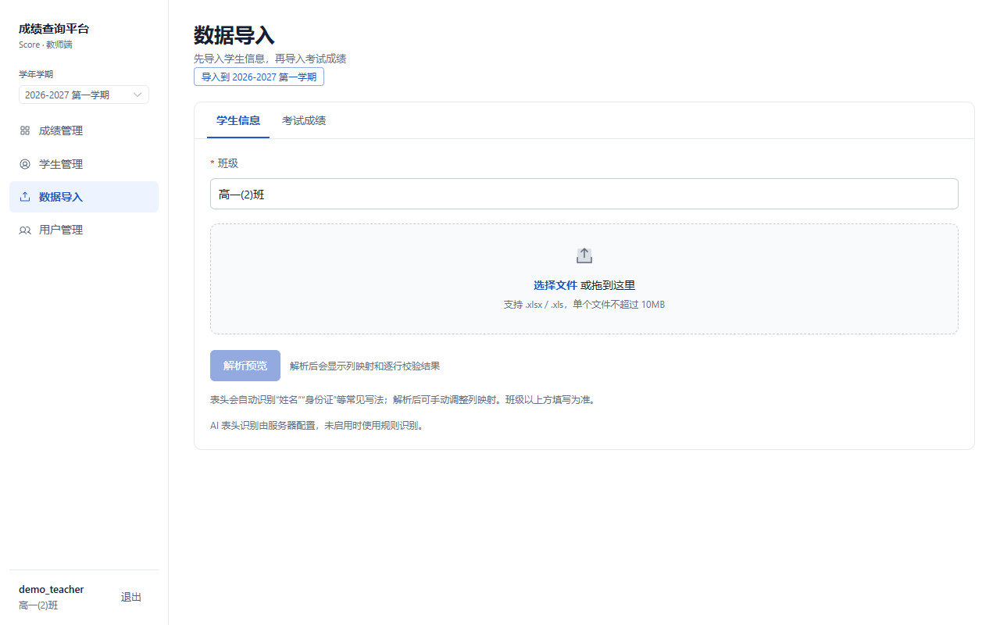
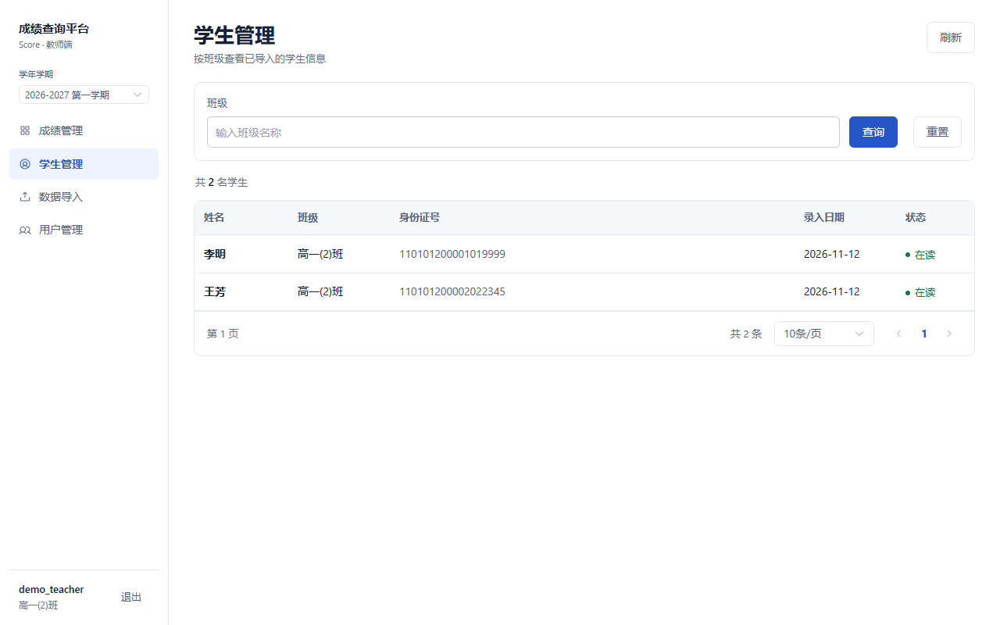
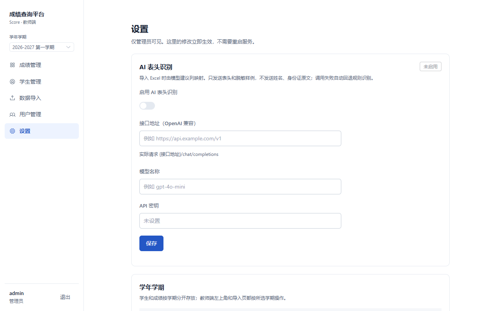

# Score Check — 轻量化成绩查询平台

> 一款面向师生的成绩管理与查询系统，支持学生在线查分、教师批量导入与数据管理。

> **分支说明**：默认分支 `master` 即当前开发与部署版本（中文亮色界面、设置页、学年学期）。`feat/chinese-light-theme` 已合并到 master，保留为历史指针。

## 界面预览

<p align="center">
  
  
</p>
<p align="center">
  
  
</p>
<p align="center">
  
  
</p>

## 功能概览

| 角色 | 功能 |
|------|------|
| **学生** | 无需登录，选择学年学期后凭姓名 + 身份证号查询个人成绩；按考试分组展示各科分数、总分与平均分；彩色等级标识（优秀/良好/及格/不及格） |
| **教师** | 工作台总览、按学生/考试搜索成绩、Excel 批量导入学生与成绩数据（列映射预览、逐行校验）、分页浏览学生名单、教师账号 CRUD；按班级和学年学期隔离数据 |
| **管理员** | 在「设置」页配置 AI 表头识别（OpenAI 兼容接口、模型、密钥），管理学年学期（新增、设为当前），绑定 GitHub 账号后用 GitHub 登录；设置入口仅 `admin` 角色可见 |

## 技术栈

**后端**

- Java 17 + Spring Boot 3.2.10
- MyBatis-Plus 3.5.7（ORM，多租户拦截器 + 分页插件）
- MySQL 8.0
- Sa-Token 1.45.0（认证与会话管理）
- Spring Security Crypto（BCrypt 密码加密）
- EasyExcel 3.3.2（Excel 导入解析）
- TianAi Captcha 1.5.5（滑块验证码）

**前端**

- Vue 3.5 + TypeScript 5.6
- Vite 5.4（构建工具）
- Element Plus 2.13（UI 组件库）
- Vue Router 4.6 + Pinia 3.0
- GSAP 3.15（页面动画）
- IBM Plex Mono（终端风格字体）

**部署**

- Docker + Docker Compose
- Caddy / Nginx（反向代理，`/score/` 路径）

## 项目结构

```
Score/
├── src/main/java/com/score/          # 后端源码
│   ├── ScoreApplication.java         # Spring Boot 入口
│   ├── common/                       # 统一响应体、全局异常处理
│   ├── config/                       # Sa-Token、MyBatis-Plus、验证码配置
│   ├── controller/                   # REST 接口（ScoreCheckController、SettingsController、CaptchaController）
│   ├── entity/                       # 数据模型（Admin、Student、Score、AcademicTerm、AppSetting）
│   ├── mapper/                       # MyBatis-Plus Mapper 接口
│   ├── service/                      # 业务逻辑层
│   └── Listener/                     # EasyExcel 导入监听器
├── src/main/resources/               # 后端资源配置
│   ├── application.yml               # 数据库、认证、验证码等配置
│   ├── bgimages/                     # 验证码背景图
│   └── banner.txt                    # 启动横幅
├── score-frontend/                   # 前端子项目
│   ├── src/
│   │   ├── api/                      # API 请求模块
│   │   ├── components/               # 公共组件（滑块验证码）
│   │   ├── layouts/                  # 布局组件（教师工作台）
│   │   ├── views/                    # 页面视图
│   │   ├── stores/                   # Pinia 状态管理
│   │   ├── router/                   # 路由配置
│   │   └── utils/                    # 请求拦截器等工具
│   └── vite.config.ts                # Vite 构建配置
├── Dockerfile                        # 后端容器镜像
├── docker-compose.yml                # 一键编排 MySQL + 后端
└── pom.xml                           # Maven 依赖管理
```

## 数据库表

| 表名 | 说明 | 关键字段 |
|------|------|----------|
| `admin` | 教师/管理员账号 | username, password (BCrypt), className, role (`admin` / `teacher`), delFlag |
| `student` | 学生信息（按学期） | studentName, className, idCard, academicYear, semester, delFlag |
| `score` | 成绩记录（按学期） | studentName, className, idCard, academicYear, semester, examName, subject, score, delFlag |
| `academic_term` | 学年学期 | academicYear (如 `2026-2027`), semester (`1` / `2`), isCurrent, delFlag |
| `app_setting` | 运行期设置 | settingKey, settingValue, updatedAt（AI 配置等，数据库优先于环境变量） |
| `oauth_state` | GitHub 授权 state | state, mode (`login` / `bind`), adminUsername, expiresAt（10 分钟一次性） |
| `login_ticket` | OAuth 登录一次性票据 | ticket, token, expiresAt（60 秒，换取登录态后删除） |

`student` / `score` / `academic_term` 含 `del_flag` 软删除标记（`0`=正常，`1`=已删除）。
按学年 + 学期隔离数据，默认当前学期为 `2026-2027 第一学期`。

## API 接口

所有接口位于 `/scoreCheck` 路径下，前端通过 `/score/api` 代理转发。

| 方法 | 路径 | 说明 | 鉴权 |
|------|------|------|------|
| POST | `/scoreCheck/StudentCheck` | 学生查询成绩（可按学期） | 无 |
| GET | `/scoreCheck/terms` | 学年学期列表 | 无 |
| POST | `/scoreCheck/login` | 教师登录（连续失败后才要求验证码） | 无 |
| GET | `/scoreCheck/loginPolicy` | 查询是否需要验证码或已被限速 | 无 |
| POST | `/scoreCheck/logout` | 退出登录 | ✅ |
| GET | `/scoreCheck/me` | 当前登录账号与角色 | ✅ |
| POST | `/scoreCheck/checkList` | 教师查询成绩列表（可按学期） | ✅ |
| POST | `/scoreCheck/import/student/preview` | 学生导入预览（列映射 + 校验） | ✅ |
| POST | `/scoreCheck/import/student/commit` | 学生导入提交 | ✅ |
| POST | `/scoreCheck/import/score/preview` | 成绩导入预览 | ✅ |
| POST | `/scoreCheck/import/score/commit` | 成绩导入提交 | ✅ |
| POST | `/scoreCheck/importStudent`、`/importScore` | 旧版直接导入（保留兼容） | ✅ |
| POST | `/scoreCheck/creatAdmin` | 创建教师账号 | ✅ |
| GET | `/scoreCheck/getUserList` | 分页获取教师列表 | ✅ |
| POST | `/scoreCheck/updateUser` | 更新教师信息 | ✅ |
| DELETE | `/scoreCheck/{userName}` | 删除教师账号（软删） | ✅ |
| POST | `/scoreCheck/getStudent` | 分页获取学生列表（可按学期） | ✅ |
| GET / PUT | `/scoreCheck/settings/ai` | 读取 / 保存 AI 表头识别设置 | 仅管理员 |
| POST | `/scoreCheck/settings/terms` | 新增学年学期 | 仅管理员 |
| POST | `/scoreCheck/settings/terms/{id}/current` | 设为当前学期 | 仅管理员 |
| GET | `/scoreCheck/auth/github/status` | GitHub 登录是否已配置 | 无 |
| GET | `/scoreCheck/auth/github/authorize` | 获取 GitHub 登录跳转地址 | 无 |
| GET | `/scoreCheck/auth/github/callback` | GitHub 回调（登录 / 绑定） | 无 |
| POST | `/scoreCheck/auth/ticket` | 一次性票据换取登录态 | 无 |
| GET / POST | `/scoreCheck/settings/github`、`/github/authorize`、`/github/unbind` | 查看 / 绑定 / 解除 GitHub | 仅管理员 |
| POST | `/captcha/genCaptcha` | 生成验证码 | 无 |
| POST | `/captcha/check` | 校验验证码 | 无 |

## 快速开始

### 前置条件

- JDK 17+
- Maven 3.6+
- Node.js 18+ / npm
- MySQL 8.0
- Docker & Docker Compose（可选，用于一键部署）

### 本地开发

**1. 初始化数据库**

```sql
CREATE DATABASE score DEFAULT CHARACTER SET utf8mb4 COLLATE utf8mb4_unicode_ci;
```

**2. 配置后端**

编辑 `src/main/resources/application.yml`，修改数据库连接信息：

```yaml
spring:
  datasource:
    url: jdbc:mysql://localhost:3306/score?useUnicode=true&characterEncoding=utf-8&serverTimezone=Asia/Shanghai
    username: root
    password: your_password
```

**3. 启动后端**

```bash
mvn spring-boot:run
```

后端默认运行在 `http://localhost:8080`。

**4. 启动前端**

```bash
cd score-frontend
npm install
npm run dev
```

前端默认运行在 `http://localhost:5173/score/`，并通过 Vite 代理将 API 请求转发至后端。

### Docker 一键部署

```bash
docker-compose up -d
```

这将启动 MySQL 和后端应用。环境变量可通过 `.env` 文件或 `docker-compose.yml` 中的默认值覆盖。

## 环境变量

| 变量 | 说明 | 默认值 |
|------|------|--------|
| `DB_URL` | 数据库连接串 | `jdbc:mysql://localhost:3306/score?...` |
| `DB_USER` | 数据库用户名 | `score` |
| `DB_PWD` | 数据库密码 | `score123` |
| `MYSQL_ROOT_PWD` | MySQL root 密码 | `root123` |
| `SCORE_AI_ENABLED` | 是否启用 AI 表头识别（可在「设置」页覆盖） | `false` |
| `SCORE_AI_BASE_URL` | OpenAI 兼容接口地址，程序会请求 `{地址}/chat/completions` | 空 |
| `SCORE_AI_MODEL` | 模型名称 | 空 |
| `SCORE_AI_API_KEY` | 接口密钥（可留空） | 空 |
| `SCORE_AI_TIMEOUT_SECONDS` | 调用超时秒数 | `8` |
| `SCORE_PUBLIC_BASE_URL` | 站点公开地址，OAuth 回调后跳转用 | `https://score.ozoo.top` |
| `GITHUB_CLIENT_ID` | GitHub OAuth App 的 Client ID | 空（也可在管理员「设置」页填写，数据库优先） |
| `GITHUB_CLIENT_SECRET` | GitHub OAuth App 的 Client Secret | 空（设置页只回显掩码，保存后立即生效） |
| `GITHUB_REDIRECT_URI` | OAuth 回调地址 | `.../score/api/scoreCheck/auth/github/callback` |

## 设计特色

- **学年学期隔离** — 学生、成绩按 `academic_year` + `semester` 存放；教师端和学生查分页都可选择学期，默认当前学期
- **管理员设置页** — 仅 `admin` 角色可见，可在线配置 AI 表头识别、新增学期和切换当前学期
- **GitHub 登录** — Client ID / Secret 和 GitHub 绑定都在管理员「设置」页完成，保存即生效；未配置时登录按钮隐藏，未绑定的 GitHub 账号无法登录
- **自适应滑块验证码** — 首次登录免验证码；同一账号 + IP 连续失败 3 次后才要求，并按 IP 限速
- **宽松 Excel 导入** — 自动识别标题行和常见表头别名，可手动调整列映射，导入前预览逐行错误；可选 AI 建议映射（只发送表头和脱敏样例）
- **多租户隔离** — 基于 MyBatis-Plus 租户插件，教师仅可查看和管理本班数据
- **终端美学 UI** — IBM Plex Mono 等宽字体 + 琥珀色点缀 + CRT 扫描线效果，工业风终端视觉
- **亮色 / 暗色主题** — 完整的主题切换支持，适配不同使用场景

## 构建与发布

**后端打包：**

```bash
mvn clean package -DskipTests
```

生成的 JAR 位于 `target/Score-1.0.jar`。

**前端构建：**

```bash
cd score-frontend
npm run build
```

产物输出至 `score-frontend/dist/`，可部署至 Nginx，配合 `/score/` 基础路径使用。

## License

MIT
